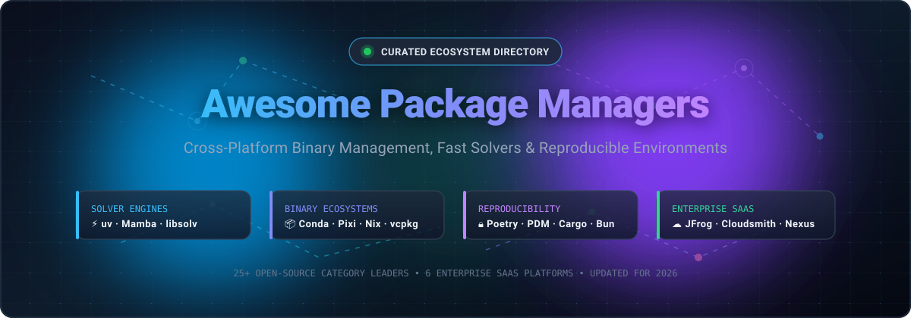
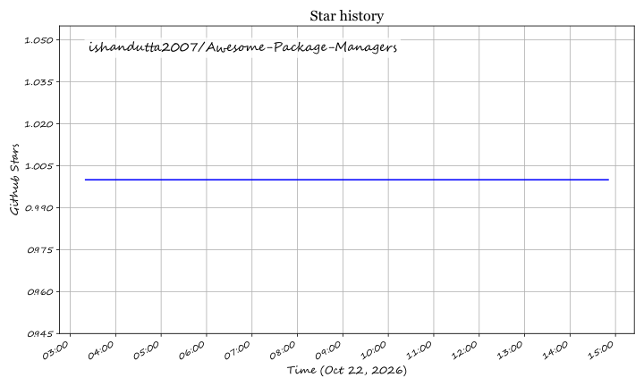

<!--
  SEO Meta Description: Curated list and technical guide of modern package managers, binary artifact repositories, and dependency resolution engines. Covers Python (uv, poetry, pip), JavaScript (bun, pnpm), C/C++ (vcpkg, conan), cross-platform binary managers (conda, pixi, nix), and enterprise SaaS artifact registries (JFrog, Cloudsmith, Sonatype Nexus).
  Keywords: package manager, dependency management, python packaging, binary artifact repository, lockfile, libsolv, pubgrub, reproducible builds, uv, conda, bun, pnpm, jfrog artifactory, cloudsmith, sonatype nexus
-->

  

# 📦 Awesome Package Managers 

       

---

## 🧭 Navigation & Table of Contents

- [🌐 Sector Overview & Market Dynamics](#-sector-overview--market-dynamics)
- [🏢 Enterprise SaaS & Hosted Package Registries](#-enterprise-saas--hosted-package-registries)
- [🚀 Top Open-Source Package Managers](#-top-open-source-package-managers)
- [🧩 Architectural Comparison & Decision Matrix](#-architectural-comparison--decision-matrix)
- [🔬 Key Evaluation Criteria for Package Managers](#-key-evaluation-criteria-for-package-managers)
- [❓ Frequently Asked Questions (FAQ)](#-frequently-asked-questions-faq)
- [🤝 How to Contribute](#-how-to-contribute)
- [💖 Support & Community](#-support--community)
- [📈 Star History](#--star-history)
- [📜 License & Disclaimer](#-license--disclaimer)

---

## 🌐 Sector Overview & Market Dynamics

The global software package management and artifact repository market is valued at **$1.8B to $2.0B**, expanding rapidly at a **12.5% CAGR toward $3.4B+ by the early 2030s** driven by software supply chain security (SSCS), enterprise SBOM compliance, continuous integration, and AI model weight management.

The sector exhibits a **concentrated oligopoly at the commercial enterprise level**—dominated by platforms like JFrog and Sonatype due to high switching costs, deep CI/CD integrations, and enterprise governance requirements—while remaining **highly fragmented across developer workflows and open-source ecosystems**, where high-speed native solvers (`uv`, `bun`, `mamba`, `pixi`) and language-specific tools fiercely compete for developer mindshare.

---

## 🏢 Enterprise SaaS & Hosted Package Registries

The following enterprise platforms provide commercial package hosting, private artifact repositories, software supply chain security, and proxy caching for public registries (PyPI, npm, Maven, Docker Hub).

*Sorted descending by company size / market valuation:*

| 🏢 Platform | 💰 Company Size (Valuation / ARR) | 🏷️ Starting Pricing | 🎁 Free Tier Limits | 🎯 Key Capabilities & Best For |
| :--- | :--- | :--- | :--- | :--- |
| **[JFrog Artifactory Cloud](https://jfrog.com/)** | **$11.4B Valuation** (Public: NASDAQ: `FROG`) / $531.8M ARR | **$150/month** (Pro Cloud tier; includes 25 GB storage & 25 GB data transfer) | **Free Forever**: 2 GB storage and 10 GB data transfer/month; includes basic Xray vulnerability scans | Universal artifact repository supporting 30+ package formats (Maven, npm, Docker, PyPI, Conan), multi-region federation, and end-to-end DevSecOps. |
| **[Anaconda Enterprise](https://www.anaconda.com/)** | **$1.5B Valuation** (Series C) / $150M ARR | **$15/user/month** (Pro / Teams tier, annual billing); custom enterprise server pricing | **Free Forever (Anaconda Core)**: Unlimited public repo downloads & local conda package management for individuals & orgs under 200 employees | Governed Conda distribution with private repository mirrors, automated CVE vulnerability curation, and enterprise data science workflow compliance. |
| **[Sonatype Nexus Cloud](https://www.sonatype.com/)** | **$1.0B+ Valuation** (Vista Equity / TPG) / ~$120M+ ARR | **$1,950/year (~$162.50/mo)** + consumption for Cloud Pro ($7,500/year for self-hosted Pro) | **Free Forever (Community Edition)**: Limited to 40,000 components or 100,000 requests/day | Universal binary repository manager backed by the stewards of Maven Central; provides automated firewall blocking of malicious open-source packages. |
| **[Cloudsmith](https://cloudsmith.com/)** | **~$800M Valuation** ($133M total funding, $72M Series C) / ~$4M+ ARR | **$149/month** (Pro tier; includes 5 GB artifact storage and 25 GB package delivery) | **Free Forever (Core plan)**: 500 MB storage and 1 GB package delivery/month; full-featured 14-day enterprise trial | 100% cloud-native universal package management SaaS with 28+ formats, multi-tenant perimeter controls, and automated software supply chain security. |
| **[ActiveState Platform](https://www.activestate.com/)** | **~$60M Valuation** (Vertu Capital backed) / ~$15M ARR | **$25,000/year (~$2,083/mo)** (SMB tier, &lt;100 employees, 1 language runtime catalog) | **Free Forever (Personal/Community)**: Strictly limited to 1 personal user (or max 2 users per org), community builds with rate limits & no SLA | Automated SLSA Level 3 build provenance, building language runtimes directly from source code, and continuous vulnerability remediation for Python and Perl. |
| **[Enthought Deployment Manager](https://www.enthought.com/)** | **~$35M Valuation** (Private / Bootstrapped) / ~$18M ARR | **$5,000/year** (Starting scientific computing engineering license & application deployment bundle) | **Free Forever**: EDM command-line binary is free for individual local use; enterprise scientific bundles include a **30-day trial** | Turnkey scientific computing distribution and desktop application environment manager designed for complex native scientific libraries (C/Fortran/Python). |

---

## 🚀 Top Open-Source Package Managers

Modern open-source package managers focus on solver speed, binary isolation, deterministic lockfiles, and cross-platform reproducibility.

*Sorted descending by GitHub Stars_Count:*

1. **[Bun](https://github.com/oven-sh/bun)**   
   **Ultra-fast all-in-one JavaScript runtime, bundler, test runner, and package manager** — MIT licensed. Written in Zig, Bun replaces `npm`, `yarn`, and `pnpm` with 25–30x faster package installations via parallelized system calls, global disk caching, and a binary lockfile (`bun.lockb` / `bun.lock`).

2. **[uv](https://github.com/astral-sh/uv)**   
   **Extremely fast Python package and project manager written in Rust** — MIT/Apache dual licensed. A single, unified binary drop-in replacement for `pip`, `pip-tools`, `poetry`, `pyenv`, `virtualenv`, and `twine`. Delivers 10–100x faster dependency resolution using PubGrub, cross-platform deterministic lockfiles (`uv.lock`), and zero-dependency Python interpreter installation (`uv python install`).

3. **[Homebrew](https://github.com/Homebrew/brew)**   
   **The missing package manager for macOS and Linux** — BSD-2-Clause licensed. Installs developer tools, command-line utilities, and desktop GUI applications (Homebrew Cask) into isolated user prefixes without requiring administrative `sudo` privileges.

4. **[Yarn](https://github.com/yarnpkg/yarn)**   
   **Deterministic dependency management for Node.js** — BSD-2-Clause licensed. Pioneered deterministic lockfiles (`yarn.lock`), offline artifact caching, monorepo workspaces, and Plug'n'Play (PnP) zero-install architectures that eliminate `node_modules` overhead.

5. **[pnpm](https://github.com/pnpm/pnpm)**   
   **Fast, disk space-efficient package manager for JavaScript/TypeScript** — MIT licensed. Uses a content-addressable global hard-link store and symlinked virtual store structure to prevent phantom dependencies and save gigabytes of local disk storage.

6. **[mise](https://github.com/jdx/mise)**   
   **Polyglot developer tool manager, environment variable manager, and task runner** — MIT licensed. Written in Rust (formerly `rtx`), it replaces `asdf`, `nvm`, `pyenv`, and `direnv` with instantaneous shell startups, shims, and declarative `.mise.toml` project profiles.

7. **[Poetry](https://github.com/python-poetry/poetry)**   
   **Comprehensive Python packaging and dependency management tool** — MIT licensed. Full-featured environment management using standard `pyproject.toml` (PEP 621), deterministic `poetry.lock` resolution, dependency groups (dev, docs, prod), and automated packaging and publishing to PyPI.

8. **[Helm](https://github.com/helm/helm)**   
   **The dedicated package manager for Kubernetes** — Apache-2.0 licensed. Manages complex cloud-native application deployments using reusable, parameterized Charts with declarative releases, rollbacks, and registry distribution via OCI artifacts.

9. **[vcpkg](https://github.com/microsoft/vcpkg)**   
   **Cross-platform C and C++ library package manager** — MIT licensed by Microsoft. Manages native open-source and proprietary C/C++ libraries across Windows, Linux, and macOS with built-in integration for CMake, MSBuild, and private enterprise registries.

10. **[winget-cli](https://github.com/microsoft/winget-cli)**   
    **Windows Package Manager CLI** — MIT licensed by Microsoft. Official command-line package manager for Windows 10 and 11, automating discovery, installation, batch upgrades, and configuration of desktop and CLI applications from validated community manifests.

11. **[asdf](https://github.com/asdf-vm/asdf)**   
    **Extensible polyglot runtime version manager** — MIT licensed. Manages multiple runtime versions (Node.js, Python, Ruby, Elixir, Go, PHP) using a modular community plugin ecosystem and a unified `.tool-versions` configuration file.

12. **[Pipenv](https://github.com/pypa/pipenv)**   
    **Python development workflow tool by PyPA** — MIT licensed. Bridges `pip` and `virtualenv` into a single automated workflow using `Pipfile` and cryptographically hashed `Pipfile.lock` definitions.

13. **[Nix](https://github.com/NixOS/nix)**   
    **Purely functional package manager and configuration system** — LGPL-2.1 licensed. Stores all packages immutably in `/nix/store` with cryptographic hashes, delivering true build reproducibility, atomic upgrades, zero-downtime rollbacks, and multi-version cohabitation.

14. **[Cargo](https://github.com/rust-lang/cargo)**   
    **The official Rust package manager and build orchestrator** — MIT/Apache dual licensed. Manages dependencies from crates.io, builds binaries and libraries, runs tests and benchmarks, and ensures reproducible builds with `Cargo.lock`.

15. **[Chocolatey](https://github.com/chocolatey/choco)**   
    **The machine package manager for Windows** — Apache-2.0 licensed. Wraps native installers, executables, and zip archives into compiled NuGet packages for automated Windows application lifecycle management and enterprise fleet provisioning.

16. **[pip](https://github.com/pypa/pip)**   
    **The official package installer for Python** — MIT licensed. The universal baseline for the Python ecosystem, installing pre-built wheels and source distributions from PyPI and custom package indexes.

17. **[Conan](https://github.com/conan-io/conan)**   
    **Decentralized, open-source C and C++ package manager** — MIT licensed. Tailored for binary package generation across complex combinations of compilers (GCC, Clang, MSVC), architectures, operating systems, and build systems (CMake, Meson, Autotools).

18. **[PDM](https://github.com/pdm-project/pdm)**   
    **Modern Python package manager with PEP 582 and PEP 621 compliance** — MIT licensed. Provides modular build backend support (flit-core, hatchling, setuptools, meson-python) alongside fast resolution and lockfile management.

19. **[Mamba](https://github.com/mamba-org/mamba)**   
    **High-performance C++ reimplementation of Conda** — BSD-3-Clause licensed. Features parallel multithreaded repository downloads and the state-of-the-art `libsolv` SAT solver for rapid dependency solving. Includes `micromamba`, a standalone, zero-dependency binary ideal for CI/CD containers.

20. **[pip-tools](https://github.com/jazzband/pip-tools)**   
    **Pinned dependency compiler and synchronizer for Python** — BSD-3-Clause licensed. Supplies `pip-compile` to generate pinned, hash-verified `requirements.txt` files and `pip-sync` to keep the active virtual environment strictly in sync.

21. **[Pixi](https://github.com/prefix-dev/pixi)**   
    **Lockfile-first package and environment management system built on Rust** — BSD-3-Clause licensed. Leverages the extensive conda-forge ecosystem to manage multi-language dependencies (Python, R, C/C++, CUDA) with modern `pixi.lock` determinism and multi-environment workspaces.

22. **[Conda](https://github.com/conda/conda)**   
    **Cross-platform binary package and environment manager** — BSD-3-Clause licensed. The foundational standard for scientific computing and machine learning, orchestrating complex native binary dependencies (CUDA, BLAS, LAPACK) across isolated environments.

23. **[Hatch](https://github.com/pypa/hatch)**   
    **Modern, extensible Python project and environment manager** — MIT licensed. Delivers matrix testing environments, PEP 621 project configuration, isolated build environments via `hatchling`, and automated package publishing.

24. **[Spack](https://github.com/spack/spack)**   
    **Flexible package manager for High-Performance Computing (HPC)** — Apache-2.0 / MIT licensed. Designed for supercomputers and scientific clusters, enabling combinatorial installations of packages across multiple compiler versions, MPI implementations, and hardware architectures.

25. **[virtualenv](https://github.com/pypa/virtualenv)**   
    **Dedicated Python environment isolation engine** — MIT licensed. The high-performance virtual environment generator that creates isolated execution trees with pre-seeded seed packages, running substantially faster than standard `venv`.

---

## 🧩 Architectural Comparison & Decision Matrix

| Tool | Primary Ecosystem | Solver Engine | Lockfile Format | Native Binary Support | Primary Strengths |
| :--- | :--- | :--- | :--- | :--- | :--- |
| **uv** | Python | PubGrub (Rust) | `uv.lock` | Wheels only | 10-100x faster installs, auto-installs Python versions, single binary |
| **Bun** | JS / TS | Native Zig Solver | `bun.lockb` / `bun.lock` | Native node addons | All-in-one runtime + package manager, fastest npm installs |
| **Poetry** | Python | Custom SAT-like | `poetry.lock` | Wheels only | Mature tooling, PEP 621 support, dependency groups, PyPI publishing |
| **Mamba / micromamba** | Cross-Language / Py | `libsolv` (C++) | `conda-lock.yml` | Full native binaries | Drops into Conda workflows, 10x faster solving, standalone executable |
| **Pixi** | Cross-Language / Py | Resolvo (Rust) | `pixi.lock` | Full native binaries | Modern lockfiles, conda-forge native, multi-environment tasks |
| **pnpm** | JS / TS | Custom link resolver | `pnpm-lock.yaml` | Native node addons | Saves gigabytes of disk via hardlinks, eliminates phantom dependencies |
| **vcpkg** | C / C++ | CMake / SAT | `vcpkg.json` | Full native binaries | Deep CMake/MSBuild integration, seamless cross-compilation |
| **Conan** | C / C++ | Custom Python-based | `conan.lock` | Full native binaries | Multi-compiler binary management (GCC, Clang, MSVC) |
| **Nix** | Universal / System | Pure functional DAG | `/nix/store` hash | Full native binaries | Unmatched reproducibility, declarative system configs, atomic rollbacks |
| **Homebrew** | macOS / Linux | Ruby dependency tree | Brewfile | Bottled binaries | Simple command-line tooling for macOS developers |

---

## 🔬 Key Evaluation Criteria for Package Managers

When selecting a package manager for modern engineering teams and CI/CD pipelines, evaluate these 5 core architectural dimensions:

1. **⚡ Solver Speed & Algorithmic Complexity**:  
   Traditional backtracking solvers (like legacy `pip` or classic `conda`) can freeze or backtrack exponentially when resolving transitive dependency conflicts. Modern engines implement either **`libsolv`** (SAT-solver technology used in Red Hat RPM and Mamba) or **PubGrub** (the next-generation SAT-based solver used in uv and Dart), slashing resolution times from minutes to milliseconds.

2. **📦 Binary vs. Source Package Handling**:  
   Standard language package managers (`pip`, `npm`) download source packages or pre-compiled wheels, but struggle when non-language system dependencies (CUDA, OpenBLAS, FFmpeg, HDF5) are required. Systems like **Conda**, **Pixi**, and **Nix** distribute complete native cross-platform binaries, preventing compilation failures on developer workstations.

3. **🔒 Lockfile Determinism & CI Reproducibility**:  
   A production-ready package manager must guarantee that running an install today yields the exact same bit-for-bit environment six months from now. Look for tools that generate cryptographically hashed, cross-platform lockfiles (`uv.lock`, `pixi.lock`, `poetry.lock`, `pnpm-lock.yaml`).

4. **💾 Disk Footprint & Symlink Architecture**:  
   Duplicating packages across dozens of microservices consumes hundreds of gigabytes of disk space. Modern managers like **pnpm** (for JavaScript) and **uv** (for Python) utilize centralized, content-addressable global caches and hard-links/reflinks to reduce disk consumption by up to 90%.

5. **🛡️ Software Supply Chain Security & Governance**:  
   Enterprise deployments require scanning packages for known CVEs, blocking malicious typosquatted libraries, enforcing license compliance (GPL, Apache, MIT), and generating Software Bills of Materials (SBOMs) compliant with SLSA standards.

---

## ❓ Frequently Asked Questions (FAQ)

### What is the fastest Python package manager in 2026?
**`uv`** (by Astral) is currently the fastest Python package manager, operating 10–100× faster than `pip` and `poetry`. It is written in Rust, uses the PubGrub solver algorithm, features a global content-addressable cache, and manages Python interpreter versions directly.

### What is the difference between Conda, Mamba, and Pixi?
- **Conda**: The original Python/R/C++ binary environment manager. Comprehensive but historically hindered by slow dependency solving.
- **Mamba**: A C++ drop-in rewrite of Conda utilizing `libsolv` for near-instant dependency solving and parallel downloads.
- **Pixi**: A modern, Rust-based package manager built on top of the conda-forge ecosystem that introduces modern lockfile semantics (`pixi.lock`), project manifests, and multi-environment support without requiring a global Conda installation.

### Why should enterprises use a private SaaS artifact repository?
Public package repositories (PyPI, npm, Maven Central, Docker Hub) provide zero uptime SLAs, occasionally suffer from supply-chain malware injection or package deletions, and do not enforce corporate licensing policies. Commercial artifact repositories (like **JFrog Artifactory**, **Cloudsmith**, and **Sonatype Nexus**) provide local proxy caching, immutable binary storage, automated vulnerability scanning, and audit trails.

### Should I choose pnpm, Yarn, or Bun for JavaScript/TypeScript?
- Choose **`Bun`** if raw installation velocity and all-in-one developer tooling (runtime + bundler + test runner + package manager) are top priorities.
- Choose **`pnpm`** if disk space efficiency, monorepo workspaces, and strict dependency isolation (preventing undeclared phantom dependencies) are paramount.
- Choose **`Yarn`** if your organization relies heavily on Yarn 4.x zero-install Plug'n'Play (PnP) architectures.

---

## 🤝 How to Contribute

We welcome community contributions, benchmarks, and new tool additions!

1. **Fork the repository** on GitHub.
2. **Add or update an entry** in `README.md` following the existing format.
3. **Include essential details**: name, official website/repo link, Stars_Count badge, licensing, and key capabilities.
4. **Submit a Pull Request** with a descriptive summary of your changes.

---

## 💖 Support & Community

If this curated directory has saved you time, streamlined your dependency stack, or helped you choose the right tooling, please consider supporting the project:

- ⭐ **Star this repository** to help other developers and DevOps engineers find it.
- 🍴 **Fork and share** with your teammates and engineering community.
- 💬 **Join the conversation** in our [Discord Community](https://discord.gg/jc4xtF58Ve).
- ☕ **Support development & maintenance** by buying a coffee via the [GitHub Sponsor Dashboard](https://github.com/sponsors/ishandutta2007).

---

##  Star History

---

## 📜 License & Disclaimer

- **License**: Released under the [MIT License](LICENSE).
- **Curated Directory**: This list is maintained for informational and educational purposes. Package manager benchmarks, solver algorithms, and enterprise pricing models evolve rapidly. Verify current pricing, SLA terms, and feature sets with respective tool authors and SaaS providers before making architectural commitments.

## Star History

<a href="https://star-history.com/#ishandutta2007/Awesome-Package-Managers&Timeline" align="center">
  <picture>
    <source media="(prefers-color-scheme: dark)" srcset="assets/ishandutta2007_Awesome-Package-Managers_growth.svg">
    
  </picture>
</a>
